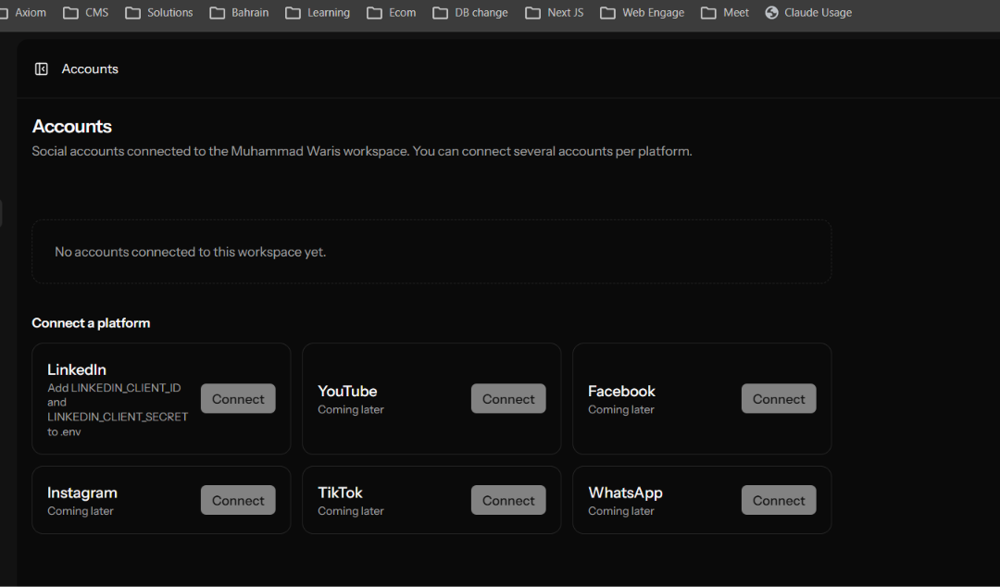
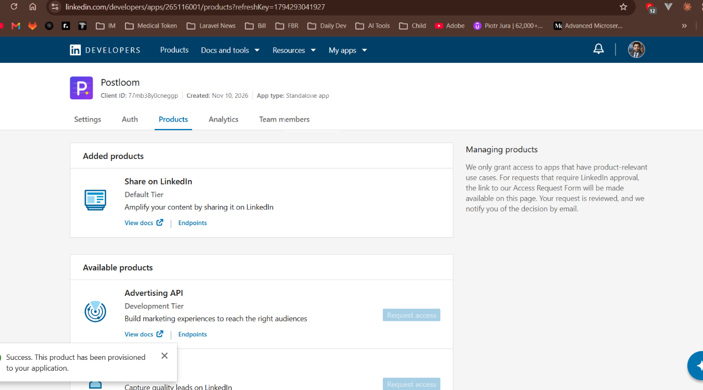
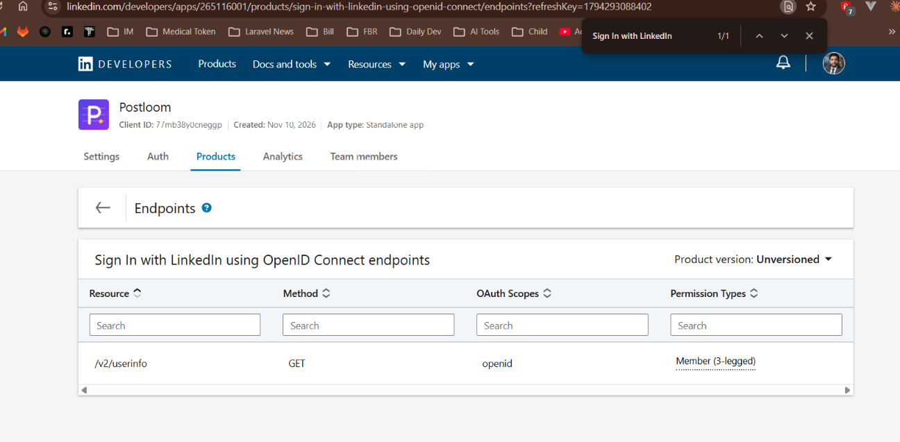
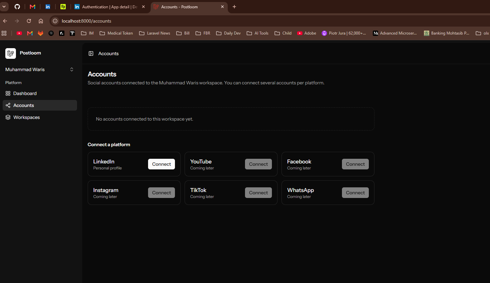
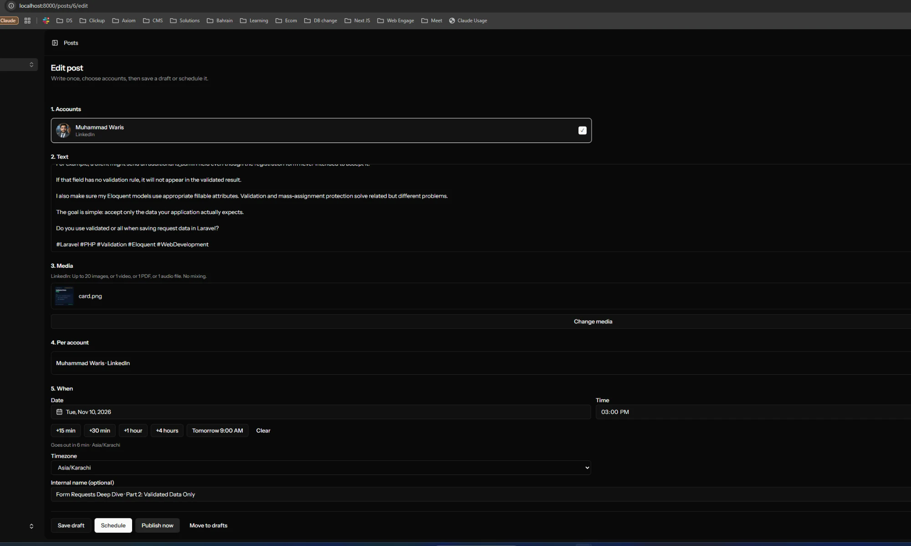
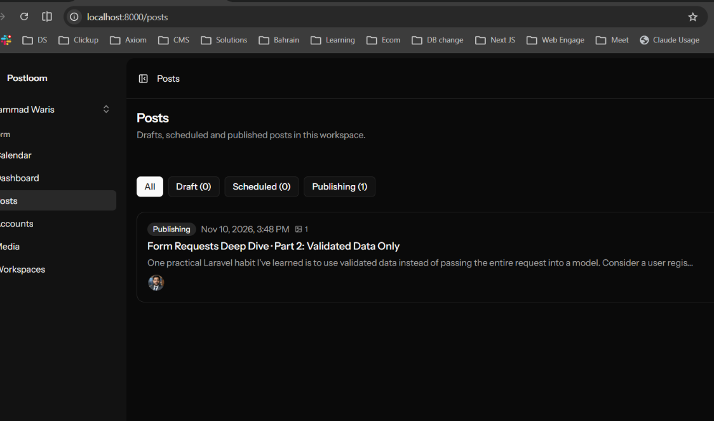

# LinkedIn setup guide (personal profile)

How to create the LinkedIn developer app, connect your profile to Postloom and send the first post. Takes about 15 minutes, once.

**Video:** [`linkedin-setup.mp4`](linkedin-setup.mp4) (the same steps as slides). Rebuild it after changing a screenshot:

```bash
powershell -File scripts/make-guide-video.ps1 linkedin
```

What you need: a LinkedIn account, and a LinkedIn Company Page you admin (any Page works, even a small one made just for this; LinkedIn requires one to own the app).

---

## 1. Before setup

Accounts → LinkedIn shows "Add LINKEDIN_CLIENT_ID and LINKEDIN_CLIENT_SECRET to .env" and Connect is disabled.



## 2. Create the app

Open <https://www.linkedin.com/developers/apps> → **Create app** and fill in:

| Field              | Value                              |
| ------------------ | ---------------------------------- |
| App name           | `Postloom`                         |
| LinkedIn Page      | your Company Page                  |
| Privacy policy URL | optional; any page you own         |
| App logo           | `docs/brand/postloom-logo-300.jpg` |
| Legal agreement    | tick it                            |


## 3. Verify the app with your Page

**Settings** tab → **Verify** → **Generate URL**. Open the URL while logged in as the Page admin and click **Verify**.


## 4. Add the two products

**Products** tab → **Request access** on:

- **Share on LinkedIn** (gives `w_member_social`, needed to post)
- **Sign In with LinkedIn using OpenID Connect** (gives `openid profile email`, needed to log in)

Both are approved at once ("Success. This product has been provisioned").



## 5. Check the products

Both show under **Added products**. The OpenID product's endpoint is `/v2/userinfo` with scope `openid`.



## 6. Add the redirect URL

**Auth** tab → **Authorized redirect URLs for your app** → add exactly:

```
http://localhost:8000/accounts/linkedin/callback
```

Under **OAuth 2.0 scopes** you should see `openid`, `profile`, `email`, `w_member_social`.


## 7. Copy the keys into `.env`

From the **Auth** tab, copy **Client ID** and **Primary Client Secret**:

```
LINKEDIN_CLIENT_ID=...
LINKEDIN_CLIENT_SECRET=...
LINKEDIN_REDIRECT_URI=http://localhost:8000/accounts/linkedin/callback
```

Never paste the secret in chat, commits or screenshots (blur it in `07-client-id-secret.png`).


## 8. Restart Postloom

```bash
php artisan config:clear
```

Run `stop.ps1`, then `start.ps1`. Accounts → LinkedIn → **Connect** is now active.



## 9. Connect your profile

Click **Connect**, sign in to LinkedIn and click **Allow**. You come back to Accounts with "<your name> is connected."


## 10. Write a post

Posts → New post: tick the LinkedIn account, write the text, add media (up to 20 images, or 1 video, PDF or audio), pick a time and **Schedule**, or **Publish now**.



## 11. It goes out

The post shows **Publishing**, then **Published** within about a minute (the scheduler checks every minute).



## 12. Check it on LinkedIn

Open the post → Delivery panel → **View post**.


---

## If something goes wrong

See the debug table in `.claude/skills/linkedin/SKILL.md` and `knowledge-base/linkedin/README.md`. Most common:

- **"redirect_uri does not match"**: the URL in step 6 must equal `LINKEDIN_REDIRECT_URI` exactly.
- **"LinkedIn did not allow posting"**: Share on LinkedIn (step 4) is missing.
- **Reconnect needed after ~60 days**: LinkedIn tokens expire; click Reconnect on Accounts.

## Screenshots still to add

Take these and save them in `docs/guides/linkedin/images/` with these exact names, then rebuild the video:

- `02-create-app-form.png`
- `03-verify-page.png`
- `06-auth-redirect-url.png`
- `07-client-id-secret.png` (blur the secret)
- `09-linkedin-consent.png`
- `12-post-on-linkedin.png`
