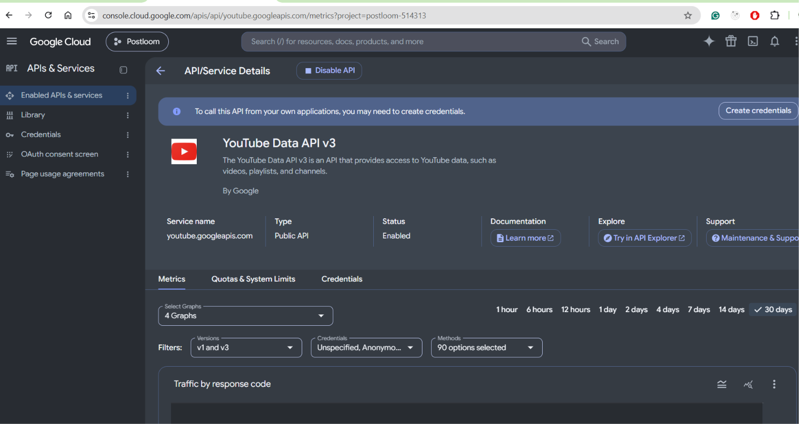
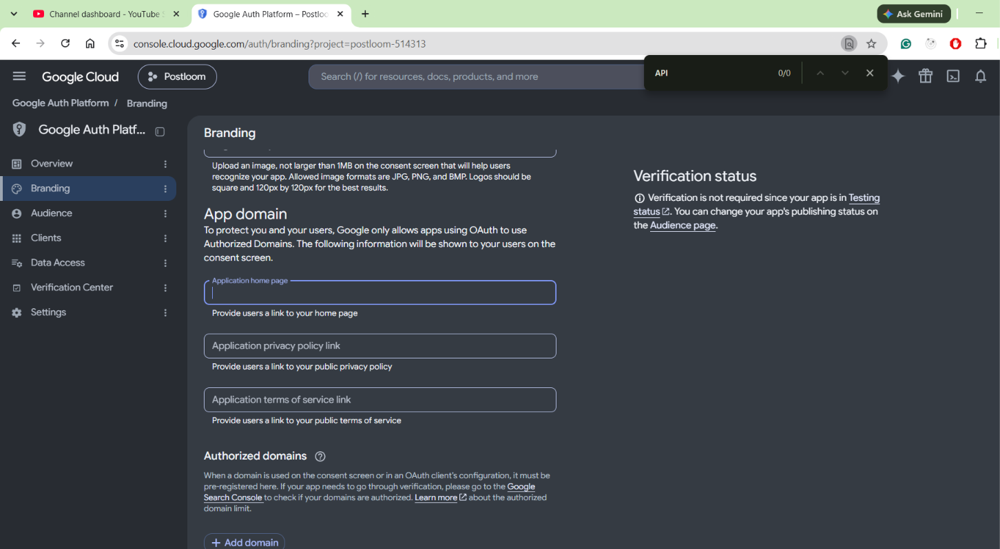
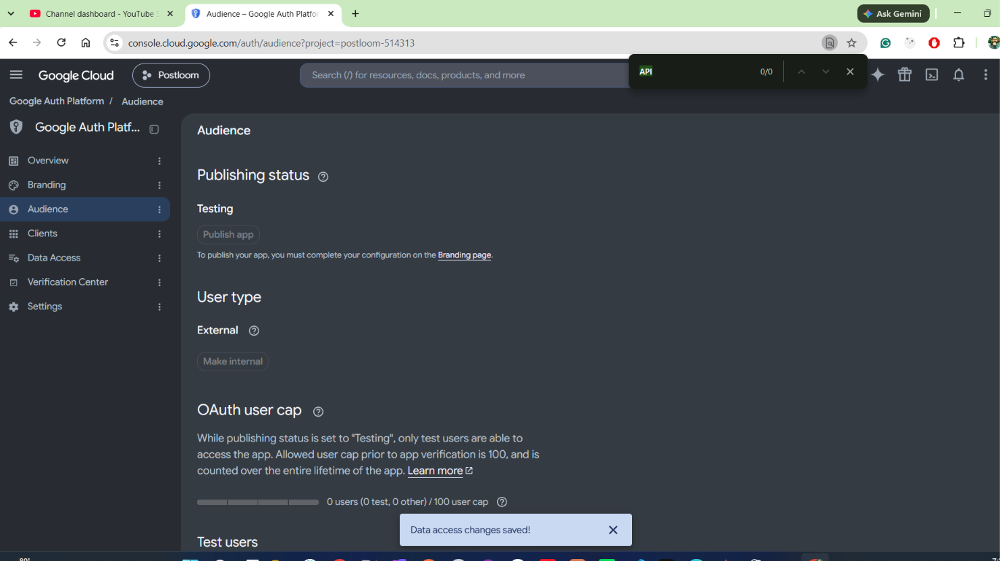

# YouTube setup guide (channel)

How to create the Google Cloud project and OAuth client, connect a YouTube channel to Postloom, and add more channels. Takes about 15 minutes, once.

**Video:** `youtube-setup.mp4`. Build it once the screenshots are in `images/` (needs the video builder from piece 09):

```bash
powershell -File scripts/make-guide-video.ps1 youtube
```

What you need: the Google account that owns (or manages) your YouTube channel(s).

---

## 1. Before setup

Accounts → YouTube shows "Add GOOGLE_CLIENT_ID and GOOGLE_CLIENT_SECRET to .env" and Connect is disabled.


## 2. Create a Google Cloud project

Open <https://console.cloud.google.com/> → project picker (top left) → **New project** → name `Postloom` → **Create**, then select it.


## 3. Turn on the YouTube Data API v3

**APIs & Services → Library** → search **YouTube Data API v3** → **Enable**.



## 4. Set up the OAuth consent screen

**Google Auth Platform** (or **APIs & Services → OAuth consent screen**) → **Get started**:

| Field              | Value        |
| ------------------ | ------------ |
| App name           | `Postloom`   |
| User support email | your email   |
| Audience           | **External** |
| Contact email      | your email   |



## 5. Add the scopes

**Data access → Add or remove scopes** → tick:

- `.../auth/youtube.upload` (upload videos)
- `.../auth/youtube.readonly` (read your channel name)

`openid`, `email` and `profile` are added by default. **Save**.


## 6. Publish the app (important)

**Audience → Publishing status → Publish app** → confirm. Status becomes **In production**.

- In **Testing** mode Google ends the login after **7 days**, so you would reconnect every week.
- In production but unverified, Google shows "Google hasn't verified this app" once when you connect. Click **Advanced → Go to Postloom (unsafe)**. That's expected for a personal app; verification is only needed for 100+ users.



## 7. Create the OAuth client

**Clients → Create client**:

| Field                    | Value                                             |
| ------------------------ | ------------------------------------------------- |
| Application type         | **Web application**                               |
| Name                     | `Postloom local`                                  |
| Authorized redirect URIs | `http://localhost:8000/accounts/youtube/callback` |

**Create**.


## 8. Copy the keys into `.env`

Copy **Client ID** and **Client secret** from the dialog (or the client's page):

```
GOOGLE_CLIENT_ID=...apps.googleusercontent.com
GOOGLE_CLIENT_SECRET=...
YOUTUBE_REDIRECT_URI=http://localhost:8000/accounts/youtube/callback
```

Never paste the secret in chat, commits or screenshots (blur it in `08-client-id-secret.png`).


## 9. Restart Postloom

```bash
php artisan config:clear
```

Run `stop.ps1`, then `start.ps1`. Accounts → YouTube → **Connect** is now active.


## 10. Connect a channel

Click **Connect** → pick your Google account → if you have brand channels, pick the **channel** → on the unverified warning click **Advanced → Go to Postloom** → tick **both** YouTube permissions → **Continue**.

You come back to Accounts with "<channel> is connected." The token line says **renews automatically**.


## 11. Add more channels

Click **Connect** again and pick a different channel (or Google account) on the Google screen. Each channel becomes its own account. To put a channel in another workspace, switch workspace first, then Connect.


---

## If something goes wrong

See `.claude/skills/youtube/SKILL.md` (debug table) and `knowledge-base/youtube/README.md`. Most common:

- **`redirect_uri_mismatch`**: the URI in step 7 must equal `YOUTUBE_REDIRECT_URI` exactly.
- **"Could not connect YouTube"** with `accessNotConfigured` in the log: step 3 was skipped.
- **Reconnect needed every week**: the app is still in Testing (step 6).

## Screenshots still to add

All of them: take each one while doing the setup and save it in `docs/guides/youtube/images/` with the name used above.
